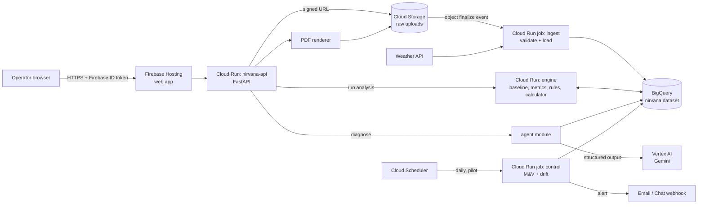

# NIRVANA – Architecture (rough draft)

*v0.1 · Nov 2026 · Status: draft for team review*

This is a first-pass architecture for the buildathon MVP, with notes on how it grows into the pilot. It follows the PRD ([PRD.md](PRD.md)); where it adds detail the PRD doesn't specify, that detail is a proposal, not a decision.

## 1. Guiding principles

1. **Rules find the waste, Gemini explains it, people approve it.**
2. **Numbers come from code, never from the LLM.** kW, GPUs, ₹, litres, payback and NPV are computed in Python. Gemini gets computed facts and returns structured reasoning.
3. **Always compare against a baseline.** High energy use isn't waste unless it beats what that hour's weather and IT load predict.
4. **Recommend, never control.** No write path to facility equipment in MVP or pilot.
5. **Work with messy data.** Validate, score quality, never invent long gaps.
6. **Customer data stays in the customer's region**, and is never used for training.

## 2. System overview: 7 layers, 1 control loop

```
┌──────────────────────────────────────────────────────────────────┐
│ 1. INPUTS                                                         │
│    Facility profile form · meter/BMS CSV · hourly weather API     │
└───────────────────────────────┬──────────────────────────────────┘
                                ▼
┌──────────────────────────────────────────────────────────────────┐
│ 2. DATA LAYER · Cloud Storage + BigQuery                          │◄──┐
│    Raw file → validated, unit-checked, time-aligned hourly table  │   │
└───────────────────────────────┬──────────────────────────────────┘   │
                                ▼                                      │
┌──────────────────────────────────────────────────────────────────┐   │
│ 3. ANALYSIS ENGINE · Python on Cloud Run  (all numbers here)      │   │
│    Baseline regression · PUE/WUE/cooling ratio · waste rules      │   │
└───────────────────────────────┬──────────────────────────────────┘   │
                                ▼                                      │
┌──────────────────────────────────────────────────────────────────┐   │
│ 4. GEMINI AGENT · Vertex AI                                       │   │ Control loop:
│    Root causes + cited evidence · 5 Whys · fishbone · fix IDs     │   │ verified savings
└───────────────────────────────┬──────────────────────────────────┘   │ feed the next
                                ▼                                      │ DMAIC cycle
┌──────────────────────────────────────────────────────────────────┐   │
│ 5. CAPACITY & MONEY CALCULATOR · Python                           │   │
│    kW freed · extra GPUs · ₹ · litres · CO₂ · payback · NPV       │   │
└───────────────────────────────┬──────────────────────────────────┘   │
                                ▼                                      │
┌──────────────────────────────────────────────────────────────────┐   │
│ 6. OUTPUTS · Web app on Firebase                                  │   │
│    Results headline · finding detail · DMAIC charter · PDF        │   │
└───────────────────────────────┬──────────────────────────────────┘   │
                                ▼                                      │
┌──────────────────────────────────────────────────────────────────┐   │
│ 7. HUMAN APPROVAL & CONTROL                                       │───┘
│    Engineer review · operator approval · work order · M&V · drift │
└──────────────────────────────────────────────────────────────────┘
```

## 3. Deployment view (Google Cloud)



**MVP simplification:** for the 2-day build, `nirvana-api`, `engine` and `agent` can be one Cloud Run service (one container, separate Python packages). Split them in the pilot when load or ownership demands it.

| Component | Service | Notes |
|---|---|---|
| Front end | Firebase Hosting | React/Next or plain SPA; 5 screens |
| Auth | Firebase Authentication | Demo login in MVP; org-scoped roles in pilot |
| API | Cloud Run (Python, FastAPI) | Stateless; verifies Firebase ID token on each call |
| Raw files | Cloud Storage | `gs://nirvana-<env>-uploads/{org}/{facility}/{upload_id}.csv` |
| Warehouse | BigQuery | One dataset per environment; partitioned by `ts`, clustered by `facility_id` |
| Analysis engine | Cloud Run (pandas, statsmodels / scikit-learn) | Deterministic; versioned rules |
| LLM | Gemini on Vertex AI | Response schema enforced; temperature 0.2 |
| Scheduling (pilot) | Cloud Scheduler + Cloud Run jobs | Daily M&V and drift checks |
| Secrets | Secret Manager | Weather API key etc. |
| Logs / audit | Cloud Logging + BigQuery `audit_log` | Prompts, outputs, approvals |
| Prototyping | Google AI Studio | Prompt iteration before wiring to Vertex |

## 4. Request flows

### 4.1 Upload → analysis (the demo path)

```mermaid
sequenceDiagram
    participant W as Web app
    participant A as API
    participant S as Cloud Storage
    participant I as Ingest
    participant B as BigQuery
    participant E as Engine
    W->>A: POST /facilities/{id}/uploads
    A-->>W: signed upload URL + upload_id
    W->>S: PUT CSV
    S->>I: finalize event
    I->>I: map columns, unit checks, gap fill <2h, DQ score
    I->>B: load readings_hourly; join weather_hourly
    W->>A: POST /facilities/{id}/analysis
    A->>E: run(facility_id)
    E->>B: read readings + weather
    E->>E: fit baseline → metrics → 5 waste rules → size in kWh/₹/L
    E->>B: write baselines, waste_findings
    E-->>A: findings ranked by ₹
    A-->>W: headline (extra GPUs, ₹/yr, L/yr) + findings
```

For the demo, ingest can run inline inside the upload request to avoid async plumbing; target is <60 s end to end on the sample CSV.

### 4.2 Diagnose a finding

1. `POST /findings/{id}/diagnose`
2. Agent builds a **fact pack** from BigQuery: pattern, window, size (kWh, ₹, L), window-vs-baseline stats, facility profile, matching fix-library entries.
3. Calls Gemini with the response schema (see §6).
4. **Guardrails** run (validate, drop uncited evidence, block unsafe fixes).
5. Calculator prices each recommended fix (CAPEX range, savings, payback, NPV, kW freed, GPUs).
6. Result stored in `diagnoses`, returned to UI.

### 4.3 Project → approval → control (pilot)

`POST /projects` creates a DMAIC charter from finding + diagnosis + priced fix. `PATCH /projects/{id}` records approve/reject with user, time and reason. After implementation, the daily control job predicts consumption from the frozen baseline at actual weather and load, writes `verifications`, and opens a new cycle if a metric breaks its control limit for 3 days in a row.

## 5. Analysis engine

```
engine/
├── ingest/       column mapping, unit normalisation, kWh→kW, gap handling, DQ score
├── baseline/     regression: facility_kw, cooling_kw, water_l ~ f(dry_bulb, wet_bulb, it_kw, hour)
├── metrics/      PUE, WUE, cooling kW per IT kW, headroom (hourly → daily → monthly)
├── rules/        one module per pattern, common interface
│   ├── overcooling.py
│   ├── air_mixing.py
│   ├── cooling_degradation.py
│   ├── missed_free_cooling.py
│   └── water_overuse.py
├── calculator/   capacity, money, water, CO₂, payback, NPV
├── fixes/        fix library (YAML): id, pattern, description, capex range, typical saving %, risk
└── safety/       ASHRAE, redundancy and SLA limit checks
```

**Rule interface (proposal)**

```python
class WasteRule(Protocol):
    id: str                      # "overcooling"
    version: str                 # bump when thresholds change
    required_columns: list[str]  # skip rule cleanly if data is missing

    def detect(self, df: pd.DataFrame, baseline: Baseline, profile: Facility) -> list[Finding]: ...
```

Each `Finding` carries `pattern, start_ts, end_ts, kwh_lost, inr_lost, litres_lost, confidence, evidence_metrics{}`. `evidence_metrics` is what Gemini is allowed to cite.

**Baseline (MVP):** ordinary least squares or gradient-boosted regression on a training window, reporting R² and CV(RMSE) per site (ASHRAE Guideline 14 style). Waste = actual − predicted where the gap is persistent and the rule's physical condition holds.

**Data quality score (0–100):** weighted on completeness of required columns, % rows rejected, % hours interpolated, PUE outliers. Shown on every analysis; low scores lower finding confidence.

## 6. Gemini agent

**Contract:** Gemini receives computed facts and returns structured JSON. It never calculates money or GPUs.

**Input fact pack**
- Waste pattern, window, size (kWh, ₹, L) from the rules engine
- Window vs baseline stats: PUE, cooling kW/IT kW, temperatures, weather
- Facility profile: cooling type, equipment age, redundancy, SLA limits
- Matching fix-library entries with cost ranges

**Output schema (abridged)**

```json
{
  "finding_id": "F-0012",
  "root_causes": [{
    "rank": 1, "cause": "Chiller condenser fouling", "confidence": 0.72,
    "evidence": ["cooling kW per IT kW up 18% vs baseline at same wet-bulb", "approach temperature up 2.1 C"],
    "missing_evidence": ["condenser water delta-T log"],
    "field_test": "Measure condenser approach temperature before and after cleaning"
  }],
  "five_whys": ["..."],
  "fishbone": {"machine": [], "method": [], "measurement": [], "environment": [], "people": [], "material": []},
  "recommended_fix_ids": ["FIX-CHILLER-CLEAN"],
  "risks": [{"risk": "Chiller offline during cleaning", "mitigation": "Use N+1 standby chiller"}],
  "charter_text": {"problem": "...", "goal": "...", "scope": "..."}
}
```

**Guardrails (in code, after the call)**

| Check | Action on failure |
|---|---|
| Response matches schema | Retry once, then mark "needs engineer review" |
| Each evidence item references a metric in the fact pack | Drop the claim |
| `recommended_fix_ids` exist in fix library | Drop unknown IDs |
| Fix would breach ASHRAE / redundancy / SLA | Block before display |
| ≥2 evidence items per root cause (US-5) | Lower confidence, flag |

Temperature 0.2. All prompts and outputs logged to `audit_log`. A cached diagnosis per demo finding covers network failure on stage.

**Chat (P1, US-12):** same grounding: retrieve facility facts from BigQuery, answer in Hindi or English, cite the numbers used.

## 7. Data model (BigQuery)

| Table | Grain | Key fields |
|---|---|---|
| `facilities` | facility | facility_id, org_id, grid_kw, gpu_count, kw_per_gpu, cooling_type, tariff_inr_kwh, water_inr_kl, city |
| `uploads` | upload | upload_id, facility_id, gcs_uri, rows, date_from, date_to, dq_score, status |
| `readings_hourly` | facility × hour | facility_id, ts, facility_kw, it_kw, cooling_kw, water_l, supply/return temps, chw temps, gpu fields, interpolated flag |
| `weather_hourly` | city × hour | city, ts, dry_bulb_c, wet_bulb_c, rh_pct |
| `baselines` | facility × model version | facility_id, model_id, target, r2, cv_rmse, trained_on, params |
| `waste_findings` | finding | finding_id, facility_id, pattern, rule_version, start_ts, end_ts, kwh_lost, inr_lost, litres_lost, confidence |
| `diagnoses` | finding × run | finding_id, model, prompt_hash, output_json, guardrail_status |
| `projects` | DMAIC project | project_id, finding_id, fix_id, status, capex_inr, savings_inr_yr, payback_m, npv_inr, owner, approver |
| `verifications` | project × week | project_id, week, predicted_kwh, actual_kwh, saved_kwh, ci_low, ci_high |
| `audit_log` | event | ts, user, org_id, action, entity, detail |

`readings_hourly` and `weather_hourly` are partitioned by `DATE(ts)` and clustered by `facility_id` / `city`. Every row carries `org_id` for tenancy filters.

## 8. API

All endpoints on Cloud Run behind Firebase Auth; every call scoped to the caller's organisation.

| Endpoint | Method | Purpose |
|---|---|---|
| `/facilities` | POST, GET | Create / list facility profiles |
| `/facilities/{id}/uploads` | POST | Get signed URL; load CSV into BigQuery |
| `/facilities/{id}/analysis` | POST | Baseline, metrics, waste rules → ranked findings |
| `/findings/{id}/diagnose` | POST | Gemini root cause → JSON contract + priced fixes |
| `/projects` | POST, PATCH | Create DMAIC project; approve/reject with reason |
| `/projects/{id}/verification` | GET | Weekly verified savings with confidence range |
| `/projects/{id}/charter.pdf` | GET | DMAIC charter PDF (<10 s) *(proposed)* |

## 9. Front end (5 screens)

| Screen | Shows | Calls |
|---|---|---|
| 1. Facility setup | Profile form | `POST /facilities` |
| 2. Data upload | Drag-and-drop, column mapping, DQ score | `POST /uploads` |
| 3. Results | "You can add **N** GPUs without new power", ₹ and L lost/yr, PUE/WUE vs peers | `POST /analysis` |
| 4. Finding detail | Actual vs baseline chart, root causes, 5 Whys, fishbone, fixes with payback/NPV | `POST /diagnose` |
| 5. Project & control | Charter, approve, verified-savings chart, drift alerts | `/projects`, `/verification` |

The extra-GPU figure recalculates client-side when grid limit or kW/GPU changes (go/no-go item), using the same formula as the calculator.

## 10. Security and privacy

- **Tenancy:** `org_id` on every row; API derives it from the Firebase token, never from the request body.
- **Roles (pilot):** viewer, engineer, approver, admin. Only approver can move a project to `approved`.
- **Data residency:** deploy into the customer's GCP project and region for pilots (single-tenant); shared multi-tenant project only for demos and free audits.
- **Encryption:** Google-managed at rest, TLS in transit; CMEK optional for pilots.
- **No training on customer data:** Vertex AI with data-use opt-out; prompts contain aggregates, not raw meter dumps.
- **Least privilege:** separate service accounts for API, ingest, engine and control job.
- **Audit:** every approval, rejection and Gemini call logged.

## 11. Non-functional targets

| Target | How |
|---|---|
| 1 yr hourly data (~8.8k rows) analysed <5 min; demo <60 s | Vectorised pandas; BigQuery for aggregation; small model fits |
| Gemini output always valid | Response schema + retry + cached fallback |
| 99.5% uptime (pilot) | Cloud Run min instances = 1; health checks |
| Reproducible results | Versioned rules, baselines and prompts stored with each finding |

## 12. MVP vs pilot vs later

| Area | Buildathon MVP | Pilot (Q1 2027) | Later |
|---|---|---|---|
| Intake | CSV + weather | + BMS/DCIM connector (BACnet/Modbus/SNMP via edge agent → Pub/Sub) | GPU telemetry (DCGM / Prometheus) |
| Detection | 5 rules | + SPC, change-point | Fan/pump, idle GPU, stranded capacity, heat recovery |
| Workflow | Charter + PDF, simulated Control | Approvals, real M&V, drift alerts | Multi-site portfolio, knowledge base (FR-20) |
| Services | 1 Cloud Run service | Split API / engine / control | Partner APIs |
| Tenancy | Demo login | Per-customer GCP project | Portfolio + partner access |

## 13. Open questions

1. Front-end framework: plain React SPA on Firebase, or Next.js? (Pinak)
2. Weather source: Open-Meteo (free, no key) vs a paid provider for wet-bulb accuracy?
3. Baseline model: start with OLS for explainability, or gradient boosting for accuracy?
4. PDF generation: server-side (WeasyPrint) or client-side?
5. Peer benchmarks for "PUE vs peers": which public dataset do we cite?
6. Pilot deployment: our project with a regional dataset, or the customer's own GCP project from day one?
